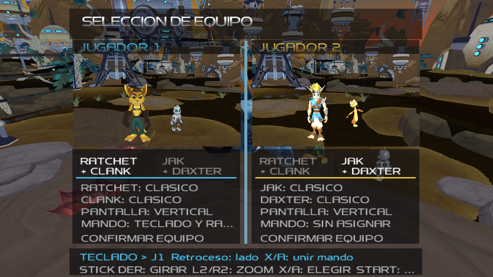

# Estado del desarrollo — 26 de octubre de 2026

**Beta pública: 0.2.1-beta.1 / V19 alpha27. Build interna: alpha42.
Progreso global: 13/100.**

La prioridad es terminar la campaña de Ratchet con Jak/Daxter. Los ensayos
siguientes pertenecen a builds internas posteriores y todavía no están incluidos
en el generador descargable. No hay una nueva release en esta actualización.

## Selección de personajes

Captura nueva de alpha42, 3840×2160, frame 4600 exacto y salida correcta. Muestra
dos paneles con pareja, aspecto, dispositivo y vista 3D. El segundo dispositivo
figura sin asignar: las entradas de esta captura fueron programadas. La ventana
permaneció oculta y sin audio, sin tomar el foco ni enviar teclas al sistema.
La captura de la [beta pública alpha27](assets/seleccion-personajes.png) se conserva
por separado. No es una nueva prueba física de dos mandos.

## Avances comprobados y límites

| Área | Evidencia | Pendiente |
|---|---|---|
| Cornisas, alpha31 y regresión alpha35 | Subida en individual y cooperativo; cliente nativo y capturas 4K revisadas | Más niveles y recorridos legítimos de campaña |
| Botas magnéticas, alpha35 | Jak recorre pared y techo de Orxon y vuelve al suelo; pruebas individual y cooperativa de 9600 frames con capturas exactas y salida correcta | Progresión normal hasta estas zonas y más geometrías |
| Arma y cámara al salir, alpha35 | Recupera Blaster, apunta y dispara seis veces: 100→94 balas; la munición de J1 permanece en 100 | Otros gadgets, armas y transiciones |
| Regresiones, alpha35 | Agua→Hydro→impulso/planeo, Swingshot y cornisa comprobados en clientes nativos con capturas 4K revisadas | Repertorio completo de acciones y niveles |
| Guardado/carga de Jak como J2, alpha36 | Guarda mientras el arma está temporalmente recogida en la superficie magnética; otro proceso carga sin conceder objetos y dispara seis veces: 94→88 balas | Otros checkpoints y combinaciones de personajes |
| Confirmación de guardado, alpha36 | Corregido círculo=Sí en la confirmación original de sobrescritura; clic derecho cancela. Pausar desde J2 congela a ambos mientras J1 guarda | Comprobación física con dos mandos |
| Carga de Jak como personaje principal, alpha38 | Corregido el fallo de R2 de alpha37: carga sin conceder objetos, recupera el arma y dispara cuatro veces, 94→90 balas | Más contextos de guardado y carga |
| Raíles de Oltanis, alpha40 | J2 monta, salta y cambia del raíl 2 al 3; 8420 frames exactos, 4 HP y cámara propia | Recorridos completos y progresión normal |
| Cables de Kerwan, alpha39 | Cliente nativo: enganche, deslizamiento a 14 unidades/s, salida al suelo y recuperación del arma; comparación de física con los tres cables para ambos personajes | Recorrer todas las rutas durante la campaña |
| Saltos de Kalebo, alpha41/42 | Tramo de 1200 ticks: Ratchet y Jak individual superan obstáculos con 3 HP; Jak en J2 completa el tramo con 4 HP tras corregir su altura de muerte | Misión completa, salidas y guardado durante el recorrido |
| Transiciones de raíles, alpha41/42 | El adaptador cede a Swingshot, cornisa y magnetismo; pruebas de código y regresiones nativas | Más transiciones reales encadenadas |
| Regresiones alpha42 | Swingshot/soltar, agua→Hydro→impulso/planeo y retorno magnético; capturas 4K exactas revisadas | Repertorio completo de acciones y niveles |

En cooperativo, las pruebas aceptadas conservan dos imágenes distintas de
1920×2160 con MSAA 4 dentro de una captura de 3840×2160. Son comprobaciones
programadas de escenarios concretos, sin prueba física nueva de dos mandos.

## Armas y guardado en superficies magnéticas

Se respeta el comportamiento original: el arma se recoge durante el contacto
magnético. La prueba de alpha34 confirma que no se disparan balas en ese estado.
Un ensayo anterior que esperaba disparar en el techo falló y se conserva como
resultado negativo.

Alpha35 completa el recorrido de salida mediante movimiento programado relativo
a la cámara, sin teletransportar al personaje después de iniciar el escenario.
Tanto Jak individual como Jak en J2 vuelven a una plataforma normal de Orxon,
recuperan el arma y disparan. Esto no equivale a terminar el nivel ni la campaña.

En alpha36, el guardado de J2 conserva el arma prevista y sus 94 balas aunque
la mano viva esté ocupada por el contexto magnético. La carga positiva se realiza
en otro proceso, desde una copia privada de esa misma partida y con el mismo
EXE. Se confirma el aviso inicial de guardado y se verifican seis disparos reales,
sin añadir armas o munición al cargar. La plantilla y los archivos de partida
comprobados se mantienen sin cambios durante la carga.

El primer intento de carga de alpha36 se quedó esperando ese aviso inicial;
no se cuenta como aprobado. La comprobación positiva procede de otro cliente.

La comparación posterior de alpha37 revela un caso distinto en individual:
Ratchet recupera el Blaster y dispara tras cargar, pero Jak no lo recupera con
R2. Esto demuestra un problema de selección/disparo; no demuestra que la munición
se haya borrado. Alpha38 corrige la selección mediante R2 y lo comprueba en un
nuevo proceso nativo: carga sin conceder objetos, recupera el arma y dispara
cuatro veces, 94→90 balas. Las restricciones magnéticas se conservan.

## Kalebo: corrección por jugador

La ruta inicial sin saltos fallaba también con Ratchet. Una ruta posterior con
saltos supera el tramo en individual, pero alpha41 todavía hacía morir a J2
prematuramente: heredaba el límite de caída de J1, 115, cuando su propio contexto
de raíl necesitaba 100. Alpha42 conserva la regla original por actor. La traza
nativa confirma 100 para J2 y 115 para J1; J2 supera el tramo con vida y ambos
conservan su munición. Son unidades internas del juego, no metros medidos.

Los intentos fallidos se conservan. Los tres ensayos positivos de Kalebo
corresponden a alpha41 en individual y alpha42 en cooperativo; no son tres
ejecuciones nuevas de alpha42. Son escenarios con colocación inicial de prueba
y entradas programadas, sin completar la misión ni recorrer la campaña.

## Compilación y pruebas

Alpha42 supera 840 pruebas del núcleo (1 ignorada), 169 del motor (3 ignoradas)
y compila el ejecutable. Las comparaciones con los datos originales de raíles y
cables pasan; la comparación magnética repetida con su ruta de salida
configurada también pasa. Cuatro clientes nativos alpha42 verifican Kalebo
cooperativo, Swingshot, agua/planeo y retorno magnético. Las pruebas de código,
comparaciones de física y ensayos gráficos se registran por separado.

## Próximos hitos

1. Adaptar la regla de caída de Fleet por jugador; la corrección de Kalebo no cubre todos los niveles.
2. Comprobar salidas de raíles, guardado/carga y transiciones encadenadas.
3. Ampliar las pruebas de gadgets y recorridos legítimos de campaña.
4. Recorrer la campaña de Ratchet con Jak hasta créditos antes de darla por completada.

Las poses, manos, anclajes de compañeros y escapes siguen siendo experimentales.
La confirmación física histórica de DualSense Edge Bluetooth en menú y reconexión
no se amplía a estas builds. Ambas campañas completas, los viajes entre universos
y la compatibilidad completa con mandos siguen pendientes.

La descarga y sus hashes continúan documentados en [VERIFICATION.md](VERIFICATION.md).
