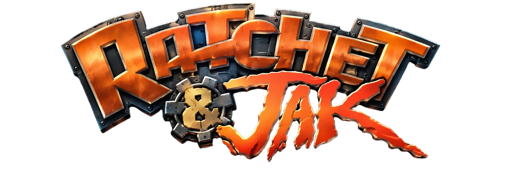
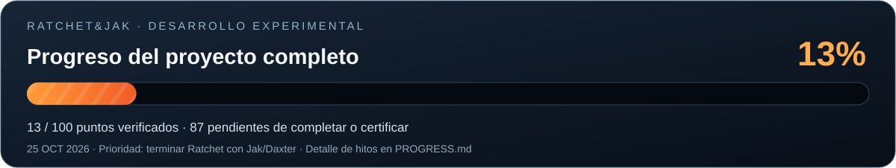
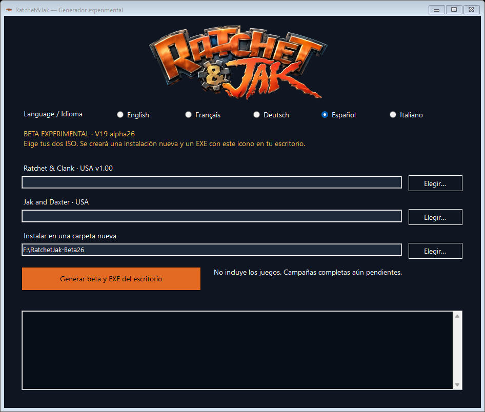
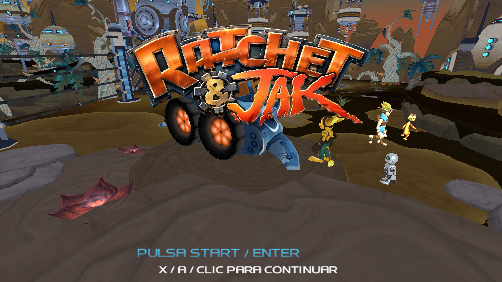
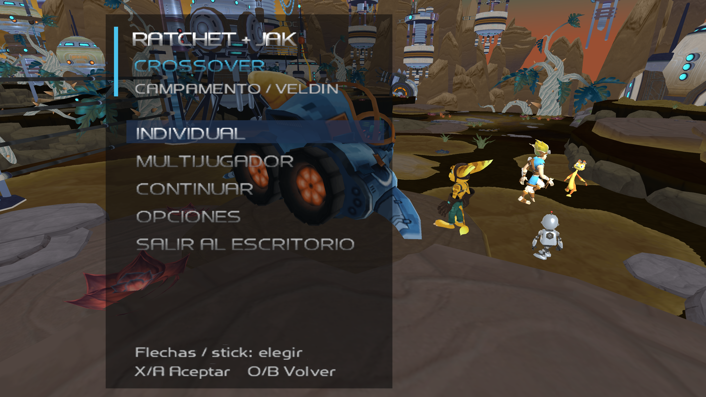
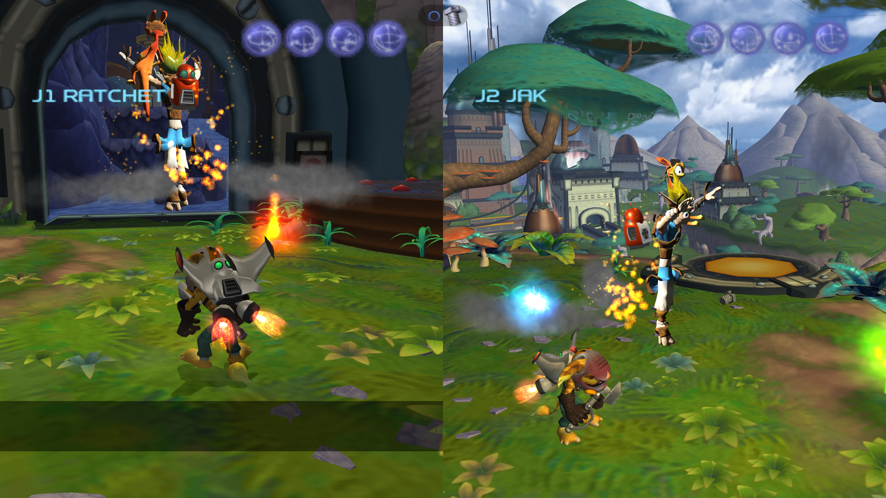

# Ratchet&Jak — beta experimental

Un crossover no oficial para PC, en desarrollo. **Esta descarga genera la beta
V19 alpha27. No es un juego terminado ni contiene las dos campañas completas.**

## Progreso del proyecto

**13 / 100 puntos del alcance completo.** Consulta el
[desglose detallado de áreas, pesos e hitos](PROGRESS.md). La barra muestra el
progreso verificado del proyecto; el avance de la instalación aparece por separado
en el generador. Ambas campañas completas siguen pendientes.

## Avances de desarrollo — 26 de octubre de 2026

Las pruebas internas más recientes cubren agarres y subida de cornisas, además
de paredes y techos magnéticos en Orxon con Jak. La recuperación del arma y la
cámara al volver al suelo sigue en verificación. Estos cambios todavía no están
en el generador público 0.2.1 / alpha27. Consulta el [estado detallado](DEVELOPMENT.md).

[Ver la captura real de selección de personajes](assets/seleccion-personajes.png).

## Descargar

**[Descargar el generador EXE para Windows x64](https://github.com/MarcPique/Ratchet-Jak-Crossover/releases/download/v0.2.1-beta.1/RatchetJak-Generador-Beta-0.2.1.exe)**

[Release, cambios y suma SHA-256](https://github.com/MarcPique/Ratchet-Jak-Crossover/releases/tag/v0.2.1-beta.1)

El generador incluye el motor probado y las herramientas de conversión. No hace
falta instalar Rust, Python, OpenGOAL ni un SDK de desarrollo. Los datos comerciales
se extraen y verifican **localmente desde tus dos ISO compatibles**; no se descargan
ni se incluyen ISO, modelos, texturas, música o partidas comerciales en el paquete.

## Cómo generar la beta

1. Descarga y abre `RatchetJak-Generador-Beta-0.2.1.exe` en Windows x64 con .NET
   Framework 4.8. La aplicación utiliza tu usuario normal.
2. Elige el idioma: **español, inglés, francés, alemán o italiano**. Los menús del
   juego se preconfiguran con esa elección y luego pueden cambiarse en Opciones.
3. Selecciona la ISO de **Ratchet & Clank PS2 USA NTSC-U v1.00, SCUS_971.99**.
4. Selecciona la ISO de **Jak and Daxter: The Precursor Legacy PS2 USA NTSC-U,
   SCUS_971.24**.
5. Elige una carpeta **nueva o vacía** en un disco con espacio suficiente. El
   programa calcula la reserva necesaria antes de extraer.
6. Pulsa **Generar beta y EXE del escritorio** y espera al mensaje `LISTO`.
7. Abre **Ratchet&Jak.exe** desde tu escritorio. Lleva el logo del proyecto como
   icono. Conserva la carpeta de instalación: el EXE del escritorio inicia el
   motor y los datos que se han generado allí.

El juego arranca en **fullscreen sin bordes**, con la **resolución física del
monitor** y escala interna del 100%. La instalación inicial conserva el idioma
elegido; el lanzador no lo fuerza después de cambiarlo en Opciones.

La imagen del instalador corresponde a 0.2.0; 0.2.1 mantiene el diseño y los cinco idiomas.

Si ya existe un EXE con ese nombre, se crea otro con un número, sin sustituirlo.
El generador tampoco actualiza ni borra instalaciones o partidas existentes.

**No admite la edición PAL de Ratchet SCES_509.16**, aunque puedas jugarla con otro
programa. También se rechazan CHD, BIN, discos de PS3, archivos comprimidos e ISO
renombradas. Ratchet se comprueba por serial, hash del ELF y hashes de extracción;
OpenGOAL valida la revisión completa de Jak. No se convierten ediciones distintas.

## Qué hay en esta beta

- Ratchet/Clank y Jak/Daxter seleccionables en el menú personalizado.
- Cooperativo local con dos cámaras reales y pantalla dividida vertical por
  defecto; selección de dispositivos y aspectos disponibles.
- Jak con Daxter en el hombro y un **Clank naranja metalizado** adicional.
- Armas de Ratchet, Nanotech para Jak, guitones compartidos y cuatro poderes Eco.
- Planeo, impulso, buceo/Hydro-Pack y Swingshot adaptados para Jak. Las mejoras
  deben obtenerse en una partida normal.
- Inicio con el logo Ratchet&Jak, fondo de Veldin y menú translúcido con personajes.

La prioridad actual es completar la campaña de Ratchet con Jak/Daxter.
**La campaña de Jak todavía está pendiente**: su ISO aporta personajes,
animaciones y recursos necesarios para esta beta.

## Capturas reales

La pantalla START corresponde a **alpha27 / 0.2.1**: muestra una única indicación
según el dispositivo activo y la asignación del botón. Ejemplos: **ENTER** con
teclado, **OPTIONS** en DualSense/PS4, **START** en PS3/Xbox 360, **MENU** en Xbox
One/Series y **+** en Switch. El botón reasignado también se refleja en el texto.

Las capturas de menú y cooperativo se conservan de alpha26 / 0.2.0 y no se
presentan como ensayos nuevos de alpha27. Estas imágenes muestran el cliente
nativo generado a partir de las dos ISO durante
pruebas en segundo plano con entradas programadas. Son capturas de 3840×2160;
cada mitad vertical de cooperativo mide 1920×2160. No son maquetas ni pruebas con dos mandos físicos.

Selección multijugador en alpha27 / 0.2.1: pareja, aspectos, disposición de
pantalla y dispositivo por jugador. Las vistas 3D muestran los personajes con
sus animaciones. La captura usa entradas programadas; el segundo dispositivo
figura sin asignar y no representa una prueba con dos mandos físicos.

## Controles principales

| Acción | Teclado/ratón | Mando normalizado |
|---|---|---|
| Mover | WASD | Stick izquierdo |
| Cámara | Ratón | Stick derecho |
| Apuntar / disparar | Botones derecho / izquierdo | L2 / R2, LT / RT |
| Saltar | Espacio | X / A |
| Selector de armas | Tab / rueda | Triángulo / Y |
| Pausa compartida | Escape | Options / Menu |

Para Jak, mantener salto durante el descenso activa el planeo con una mejora
compatible; R1 + X permite el impulso contextual. Con Swingshot, R2 mantiene el
enganche y soltarlo libera. Bajo el agua se conservan los controles de contexto.

El menú de una versión anterior fue confirmado por el usuario con DualSense Edge
Bluetooth, incluida reconexión. La build usa el mismo sistema de entrada, pero
**no se certifican todos los mandos ni todas las conexiones** por pruebas sintéticas.
Las asignaciones de cada jugador deben ser independientes.

## Límites y diagnóstico

- No se ha completado la campaña entera con Jak. Otros gadgets, agarres, vehículos,
  jefes, misiones especiales y viajes siguen necesitando desarrollo y pruebas.
- Las poses, los anclajes de los compañeros y los escapes todavía requieren pulido.
- No hay multijugador por Internet en esta entrega.
- El primer arranque puede tardar mientras se preparan recursos y shaders.
- En un fallo, consulta `build.log` y `build-result.local.json` dentro del destino.
  Para reintentar utiliza otra carpeta vacía; no reutilices una extracción parcial.
- Las partidas de esta instalación están en `game/UserData`. Haz una copia antes
  de cambiar de versión.
- Tras comprobar que el juego arranca puedes borrar manualmente `.builder` para
  liberar el espacio temporal. Conserva `game` y sus subcarpetas.
- Para desinstalar, elimina únicamente esta instalación nueva y su EXE de escritorio.

No compartas la instalación generada, `Data`, los modelos, las ISO, partidas ni
registros con rutas privadas. Comparte el **generador** y el enlace a este repositorio.

## Verificación, código y créditos

Consulta [VERIFICATION.md](VERIFICATION.md) para distinguir extracción/conversión,
arranque del cliente, pruebas programadas y comprobaciones físicas pendientes.
El generador conserva `generated_not_gameplay_verified` en su manifest: generar
archivos correctamente no demuestra que una campaña pueda completarse.

El código del generador está en `src/`. El motor de esta release está fijado al
SHA-256 `8ca7e846bbeb0edaaddba651396b331fe031d6f329c7673b99b7778ee32ee52d`.
No se publica el árbol privado con recursos extraídos o fuentes de juego descompiladas.

Basado en [ReRAC](https://github.com/re-rac/rerac), las modificaciones de
[Ratchet and Clank Recomp](https://github.com/MarcPique/Ratchet-and-Clank-Recomp) y
[OpenGOAL](https://github.com/open-goal/jak-project). Se conservan sus licencias y
las de las herramientas incluidas; detalles en [THIRD_PARTY_NOTICES.md](THIRD_PARTY_NOTICES.md).

Logo facilitado por el propietario del proyecto. Desarrollo y empaquetado asistidos
por OpenAI Codex (GPT-6). Proyecto fan no oficial, sin afiliación con Sony,
Insomniac Games o Naughty Dog. Ratchet & Clank y Jak and Daxter pertenecen a sus
respectivos titulares. [Licencia del código del generador](LICENSE).
